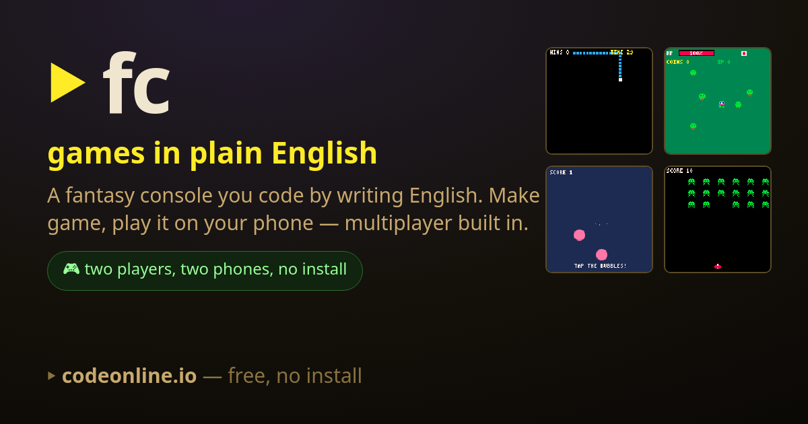

# fc — the plain-English fantasy console, for Android

Make little games by writing **plain English**. fc is a fantasy console that runs in your
browser and ships as a small Android app: type a few lines — `player is centered sprite`,
`when player picks up any coin, increase score by 1` — and a real game runs.
No setup, no syntax to memorize.

**Play right now in any browser: <https://codeonline.io>**

## Download the Android app

**[⬇ Get the latest APK](https://github.com/kevinelong/fc-releases/releases/latest)**

- Android 8.0 or newer · about 50 MB · works offline
- Tap the downloaded file, allow *install unknown apps* for your browser if it asks, and install.
- **Upgrading from the older app (1.0.2)?** Uninstall it first. This build is signed with a
  new key, so Android cannot replace the old copy in place.

## Release assets

Each release carries the two binaries plus `SHA256SUMS.txt`. The numbers below are the contract —
`bash verify-release.sh` re-downloads everything and checks every one of them against what is
actually served, and `bash verify-release.sh --dir <dir>` does the same for files you have already
downloaded. Change a release and these numbers (and the script's expectations) move with it.

| asset | bytes | sha256 |
|---|---|---|
| `app-release.apk` | 49,526,430 | `088073bb2aaf5cbe51568ff432d915988b29e8b28f0b7287a3fc7cae7e8135b2` |
| `app-release.aab` | 49,214,659 | `d565ed89c5b5820afa8d60115697690657a85486d2757622c2b3d3ff7e837914` |

These are release **`v1.0.3-4`** (12 October 2026): `versionCode` 4, `versionName` 1.0.3, signed
`CN=fc`. The Android App Bundle is for the Play listing; for a phone, use the APK.

## What is in the app

- The full editor, with your program re-running as you type
- **22 example games** to play, read and remix — coin quests, mazes, shooters, races,
  generative toys and five multiplayer games
- Sprite, sound and map editors built in
- A step-through debugger, plain-English error messages ("Line 4: hands only has 2 items,
  but you asked for item 5"), and a *see it in real code* view that shows your program in
  Python, JavaScript, Lua or GDScript
- Accessibility settings: colourblind-safe palette, reduced motion, larger high-contrast text
- **Offline:** all of the above, with no connection needed
- **Online, optional:** multiplayer rooms, cloud saves and the community gallery (sign in)

## Other ways to play

- **Browser or PWA:** <https://codeonline.io> — on Android or iOS use *Add to Home Screen*
  to install it as an offline app, with no download at all.
- **Google Play:** the same app is attached to each release as an Android App Bundle
  (`app-release.aab`); the store listing is still pending. For installing on a phone, use the APK.

## Links

- Source code, documentation and the full language reference: <https://github.com/kevinelong/fc>
- What changed in each build: [CHANGELOG.md](./CHANGELOG.md)
- Privacy policy: <https://codeonline.io/privacy/>

## License

Source-available under the **[Functional Source License 1.1](./LICENSE)** (`FSL-1.1-MIT`):
use the app for anything except a product or service that competes with fc, and each release
converts to the MIT license two years after it is published. Using it in a classroom, at home
or inside a company is squarely within the grant. Made by
[Kevin Long](https://www.linkedin.com/in/kevinelong/).
